# Assets de jeux

Sous-catégorie de [Bibliothèque 3D](../Biblioth%C3%A8que%203D.md) · **56 éléments**

| Aperçu | Élément | Infos |
| --- | --- | --- |
|  | [Break Effect · Glass Bridge](Break%20Effect%20%C2%B7%20Glass%20Bridge.md) | Modèle en Parts · 15 × 1 × 14 · 28 Parts |
| 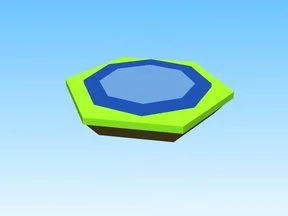 | [Daily Reward · Tapping Lords](Daily%20Reward%20%C2%B7%20Tapping%20Lords.md) | Modèle en Parts · 17 × 1 × 17 · 10 Parts |
| 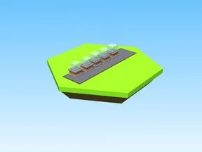 | [Dominus Hats · Cashgrab Bridge](Dominus%20Hats%20%C2%B7%20Cashgrab%20Bridge.md) | Modèle en Parts · 2 × 3 × 19 · 27 Parts · 7 MeshParts |
| 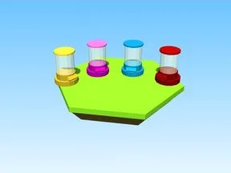 | [Eggs · Magnet Simulator 2](Eggs%20%C2%B7%20Magnet%20Simulator%202.md) | Modèle en Parts · 25 × 10 × 22 · 20 Parts · 25 MeshParts |
| 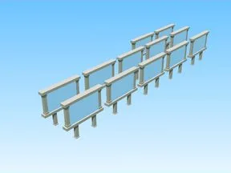 | [Gamepass SIgns Clone · Robot Simulator](Gamepass%20SIgns%20Clone%20%C2%B7%20Robot%20Simulator.md) | Modèle en Parts · 14 × 10 × 67 · 192 Parts |
|  | [Gem Boost Pads · Robot Simulator](Gem%20Boost%20Pads%20%C2%B7%20Robot%20Simulator.md) | Modèle en Parts · 22 × 43 × 20 · 36 Parts · 11 MeshParts |
|  | [Gift for brennan · Punch Simulator](Gift%20for%20brennan%20%C2%B7%20Punch%20Simulator.md) | Modèle en Parts · 9 × 4 × 1 · 14 Parts |
|  | [Glass · Glass Bridge](Glass%20%C2%B7%20Glass%20Bridge.md) | Modèle en Parts · 326 × 1 × 19 · 36 Parts |
| 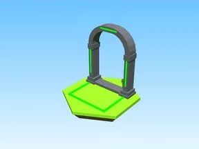 | [Grassland Portal · Robot Simulator](Grassland%20Portal%20%C2%B7%20Robot%20Simulator.md) | Modèle en Parts · 10 × 13 × 8 · 26 Parts · 1 MeshPart |
| 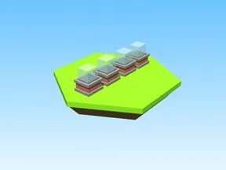 | [Hats1 · Cashgrab Bridge](Hats1%20%C2%B7%20Cashgrab%20Bridge.md) | Modèle en Parts · 1 × 3 × 15 · 20 Parts · 6 MeshParts |
| 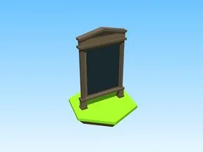 | [Limited Time Sale · Bakery Simulator](Limited%20Time%20Sale%20%C2%B7%20Bakery%20Simulator.md) | Modèle en Parts · 3 × 16 × 9 · 20 Parts |
| 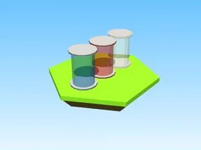 | [Magic Carpet Speed Coil and Gravity Coil Givers · Cashgrab Bridge](Magic%20Carpet%20Speed%20Coil%20and%20Gravity%20Coil%20Givers%20%C2%B7%20Cashgrab%20Bridge.md) | Modèle en Parts · 1 × 7 × 12 · 15 Parts · 3 MeshParts |
|  | [Magmaland Portal · Robot Simulator](Magmaland%20Portal%20%C2%B7%20Robot%20Simulator.md) | Modèle en Parts · 10 × 13 × 8 · 26 Parts · 1 MeshPart |
| 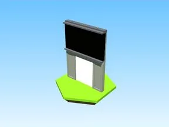 | [Main Portal Template · Punch Simulator](Main%20Portal%20Template%20%C2%B7%20Punch%20Simulator.md) | Modèle en Parts · 15 × 22 × 3 · 35 Parts · 1 MeshPart |
|  | [Morph Givers · +1 Jump Every Second](Morph%20Givers%20%C2%B7%20+1%20Jump%20Every%20Second.md) | Modèle en Parts · 1 × 5 × 19 · 26 Parts · 7 MeshParts |
|  | [Offline Donation · First Donations](Offline%20Donation%20%C2%B7%20First%20Donations.md) | Modèle en Parts · 145 × 14 × 90 · 15 Parts · 105 MeshParts |
| 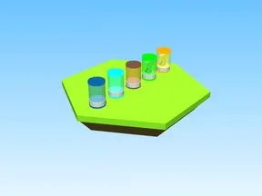 | [Package Givers · +1 Jump Every Second](Package%20Givers%20%C2%B7%20+1%20Jump%20Every%20Second.md) | Modèle en Parts · 1 × 8 × 36 · 30 Parts · 15 MeshParts |
| 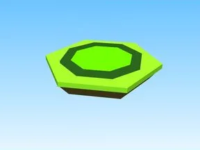 | [Pet Shop · Tapping Lords](Pet%20Shop%20%C2%B7%20Tapping%20Lords.md) | Modèle en Parts · 10 × 1 × 10 · 10 Parts |
|  | [Plots · Bakery Simulator](Plots%20%C2%B7%20Bakery%20Simulator.md) | Modèle en Parts · 151 × 6 × 93 · 204 Parts · 54 MeshParts |
| 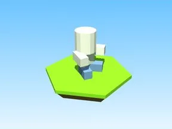 | [Plush Bacon Hair · Tapping Lords](Plush%20Bacon%20Hair%20%C2%B7%20Tapping%20Lords.md) | Modèle en Parts · 1 × 2 × 2 · 6 Parts · 1 MeshPart |
|  | [Potions · Tapping Lords](Potions%20%C2%B7%20Tapping%20Lords%20%C2%B7%20Assets%20de%20jeux.md) | Modèle en Parts · 25 × 1 × 25 · 10 Parts |
| 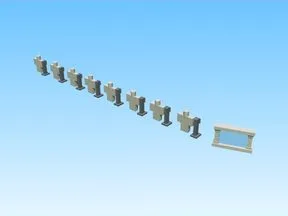 | [Shirt Displays · Robot Simulator](Shirt%20Displays%20%C2%B7%20Robot%20Simulator.md) | Modèle en Parts · 71 × 5 × 2 · 89 Parts |
| 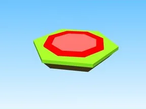 | [Shop A · Tapping Lords](Shop%20A%20%C2%B7%20Tapping%20Lords.md) | Modèle en Parts · 10 × 1 × 10 · 10 Parts |
| 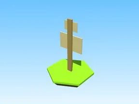 | [Sign · First Donations](Sign%20%C2%B7%20First%20Donations.md) | Modèle en Parts · 1 × 3 × 1 · 3 Parts · 2 MeshParts |
| 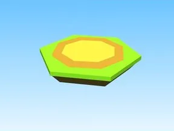 | [Star Upgrades · Tapping Lords](Star%20Upgrades%20%C2%B7%20Tapping%20Lords.md) | Modèle en Parts · 10 × 1 × 10 · 10 Parts |
| 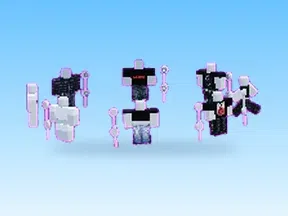 | [TIENDA · First Donations](TIENDA%20%C2%B7%20First%20Donations.md) | Modèle en Parts · 28 × 4 × 27 · 96 Parts |
| 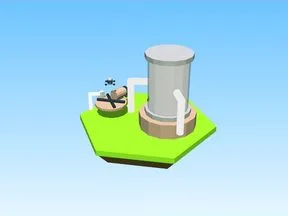 | [Touch Parts · Pet Pharmica](Touch%20Parts%20%C2%B7%20Pet%20Pharmica.md) | Modèle en Parts · 34 × 22 × 15 · 44 Parts · 10 MeshParts |
|  | [VIPGiver1 · Billionaire Tycoon](VIPGiver1%20%C2%B7%20Billionaire%20Tycoon.md) | Modèle en Parts · 5 × 5 × 4 · 14 Parts · 40 MeshParts |
| 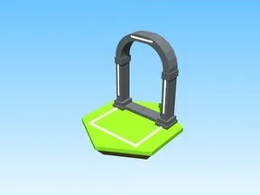 | [Winter Wonderland Portal · Robot Simulator](Winter%20Wonderland%20Portal%20%C2%B7%20Robot%20Simulator.md) | Modèle en Parts · 10 × 13 × 8 · 26 Parts · 1 MeshPart |
|  | [Modèles · +1 Health Every Second (9)](Mod%C3%A8les%20%C2%B7%20+1%20Health%20Every%20Second%20%289%29.md) | Pack de fichiers · 9 fichiers · 0,9 Mo |
|  | [Modèles · +1 Jump Every Second (11)](Mod%C3%A8les%20%C2%B7%20+1%20Jump%20Every%20Second%20%2811%29.md) | Pack de fichiers · 11 fichiers · 0,9 Mo |
|  | [Modèles · Bakery Simulator (21)](Mod%C3%A8les%20%C2%B7%20Bakery%20Simulator%20%2821%29.md) | Pack de fichiers · 21 fichiers · 3,1 Mo |
|  | [Modèles · Billionaire Tycoon (24)](Mod%C3%A8les%20%C2%B7%20Billionaire%20Tycoon%20%2824%29.md) | Pack de fichiers · 24 fichiers · 3,1 Mo |
|  | [Modèles · Cashgrab Bridge (26)](Mod%C3%A8les%20%C2%B7%20Cashgrab%20Bridge%20%2826%29.md) | Pack de fichiers · 26 fichiers · 1,9 Mo |
|  | [Modèles · First Donations (16)](Mod%C3%A8les%20%C2%B7%20First%20Donations%20%2816%29.md) | Pack de fichiers · 16 fichiers · 2,2 Mo |
|  | [Modèles · Glass Bridge (18)](Mod%C3%A8les%20%C2%B7%20Glass%20Bridge%20%2818%29.md) | Pack de fichiers · 18 fichiers · 0,9 Mo |
| 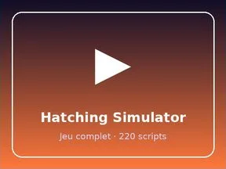 | [Modèles · Hatching Simulator (8)](Mod%C3%A8les%20%C2%B7%20Hatching%20Simulator%20%288%29.md) | Pack de fichiers · 8 fichiers · 2,8 Mo |
|  | [Modèles · Mining Masters (30)](Mod%C3%A8les%20%C2%B7%20Mining%20Masters%20%2830%29.md) | Pack de fichiers · 30 fichiers · 3,5 Mo |
|  | [Modèles · Pet Pharmica (29)](Mod%C3%A8les%20%C2%B7%20Pet%20Pharmica%20%2829%29.md) | Pack de fichiers · 29 fichiers · 3,0 Mo |
|  | [Modèles · Punch Simulator (16)](Mod%C3%A8les%20%C2%B7%20Punch%20Simulator%20%2816%29.md) | Pack de fichiers · 16 fichiers · 1,4 Mo |
|  | [Modèles · Rebirth Champions X (3)](Mod%C3%A8les%20%C2%B7%20Rebirth%20Champions%20X%20%283%29.md) | Pack de fichiers · 3 fichiers · 5,1 Mo |
|  | [Modèles · Robot Simulator (51)](Mod%C3%A8les%20%C2%B7%20Robot%20Simulator%20%2851%29.md) | Pack de fichiers · 51 fichiers · 2,6 Mo |
| 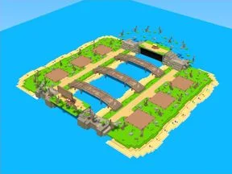 | [Modèles · Shoot A Brainrot (5)](Mod%C3%A8les%20%C2%B7%20Shoot%20A%20Brainrot%20%285%29.md) | Pack de fichiers · 5 fichiers · 1,2 Mo |
|  | [Modèles · Tapping Lords (23)](Mod%C3%A8les%20%C2%B7%20Tapping%20Lords%20%2823%29.md) | Pack de fichiers · 23 fichiers · 0,6 Mo |
|  | [Modèles · Training Simulator (9)](Mod%C3%A8les%20%C2%B7%20Training%20Simulator%20%289%29.md) | Pack de fichiers · 9 fichiers · 0,5 Mo |
|  | [Modèles · Tweeting Simulator (6)](Mod%C3%A8les%20%C2%B7%20Tweeting%20Simulator%20%286%29.md) | Pack de fichiers · 6 fichiers · 0,9 Mo |
|  | [Modèles · Magnet Simulator 2 (9)](Mod%C3%A8les%20%C2%B7%20Magnet%20Simulator%202%20%289%29.md) | Pack de fichiers · 9 fichiers · 0,4 Mo |
|  | [Drill For LuckyBlocks – modèles du Workspace](Drill%20For%20LuckyBlocks%20%E2%80%93%20mod%C3%A8les%20du%20Workspace.md) | Pack de fichiers · 26 fichiers · 0,9 Mo |
|  | [Roll A Brainrot (ZEVR) – modèles du Workspace](Roll%20A%20Brainrot%20%28ZEVR%29%20%E2%80%93%20mod%C3%A8les%20du%20Workspace.md) | Pack de fichiers · 23 fichiers · 0,2 Mo |
|  | [MiniGame (combat à l’épée par manches) – modèles du Workspace](MiniGame%20%28combat%20%C3%A0%20l%E2%80%99%C3%A9p%C3%A9e%20par%20manches%29%20%E2%80%93%20mod%C3%A8les%20du%20Workspace.md) | Pack de fichiers · 2 fichiers · 0,4 Mo |
| 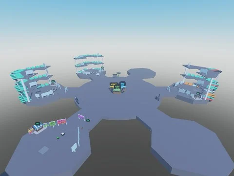 | [Mine a Planet BETA 9 (place 121125129560252) – modèles du Workspace](Mine%20a%20Planet%20BETA%209%20%28place%20121125129560252%29%20%E2%80%93%20mod%C3%A8les%20du%20Workspace.md) | Pack de fichiers · 16 fichiers · 0,4 Mo |
|  | [Unboxing Simulator – modèles du Workspace](Unboxing%20Simulator%20%E2%80%93%20mod%C3%A8les%20du%20Workspace.md) | Pack de fichiers · 86 fichiers · 0,7 Mo |
|  | [Steal An Egg (place 107778070777162) – modèles du Workspace](Steal%20An%20Egg%20%28place%20107778070777162%29%20%E2%80%93%20mod%C3%A8les%20du%20Workspace.md) | Pack de fichiers · 23 fichiers · 1,1 Mo |
| 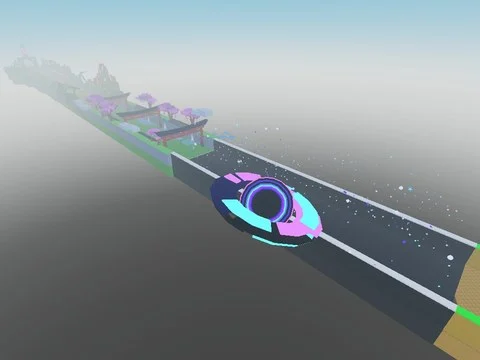 | [Steal An Egg – Better Version (clstudioo) – modèles du Workspace](Steal%20An%20Egg%20%E2%80%93%20Better%20Version%20%28clstudioo%29%20%E2%80%93%20mod%C3%A8les%20du%20Workspace.md) | Pack de fichiers · 24 fichiers · 0,9 Mo |
|  | [Steal An Egg Sourced – modèles du Workspace](Steal%20An%20Egg%20Sourced%20%E2%80%93%20mod%C3%A8les%20du%20Workspace.md) | Pack de fichiers · 24 fichiers · 1,4 Mo |
|  | [Potions (Roll Speed, Luck, Mutation)](Potions%20%28Roll%20Speed,%20Luck,%20Mutation%29.md) | Pack de fichiers · 4 fichiers · 40 Ko |
