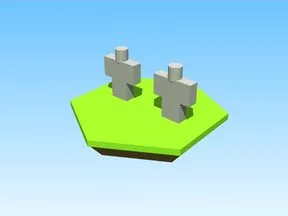

# Gift for brennan · Punch Simulator

Modèle en Parts « Gift for brennan » (Punch Simulator).

- **Catégorie** : [Bibliothèque 3D](../Biblioth%C3%A8que%203D.md)
- **Sous-catégorie** : [Assets de jeux](Assets%20de%20jeux%20%28Biblioth%C3%A8que%203D%29.md)
- **Type** : Modèle en Parts
- **Taille** : 9 × 4 × 1 studs
- **Contenu** : 14 Parts
- **Jeu d'origine** : Punch Simulator
- **Fichier source** : `Assets/models/FromGames/Punch Simulator/Workspace/gift for brennan.rbxm` (dans le vault)
