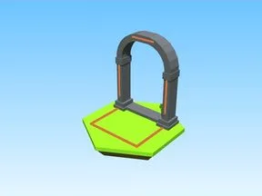

# Magmaland Portal · Robot Simulator

Modèle en Parts « Magmaland Portal » (Robot Simulator).

- **Catégorie** : [Bibliothèque 3D](../Biblioth%C3%A8que%203D.md)
- **Sous-catégorie** : [Assets de jeux](Assets%20de%20jeux%20%28Biblioth%C3%A8que%203D%29.md)
- **Type** : Modèle en Parts
- **Taille** : 10 × 13 × 8 studs
- **Contenu** : 26 Parts · 1 MeshPart
- **Jeu d'origine** : Robot Simulator
- **Fichier source** : `Assets/models/FromGames/Robot Simulator/Magmaland Portal.rbxm` (dans le vault)
