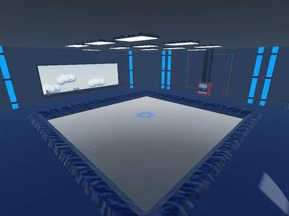

# MiniGame (combat à l’épée par manches) – modèles du Workspace

2 modèles/dossiers extraits du Workspace de MiniGame (combat à l’épée par manches) (un .rbxm par enfant, Camera/Terrain exclus).

- **Catégorie** : [Bibliothèque 3D](../Biblioth%C3%A8que%203D.md)
- **Sous-catégorie** : [Assets de jeux](Assets%20de%20jeux%20%28Biblioth%C3%A8que%203D%29.md)
- **Type** : Pack de fichiers
- **Contenu** : 2 fichiers · 0,4 Mo
- **Jeu d'origine** : MiniGame
- **Fichier source** : `Assets/models/FromGames/MiniGame` (dans le vault)

## Fichiers (2)

- `Workspace/Game.rbxm`
- `Workspace/Lobby.rbxm`
