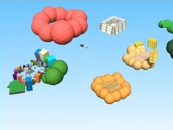

# Modèles · Tweeting Simulator (6)

6 modèles extraits du jeu Tweeting Simulator (Workspace, ReplicatedStorage…) : Boundries, Core, MinigameMap, Objects, Regions, UpdateBuilds.

- **Catégorie** : [Bibliothèque 3D](../Biblioth%C3%A8que%203D.md)
- **Sous-catégorie** : [Assets de jeux](Assets%20de%20jeux%20%28Biblioth%C3%A8que%203D%29.md)
- **Type** : Pack de fichiers
- **Contenu** : 6 fichiers · 0,9 Mo
- **Jeu d'origine** : Tweeting Simulator
- **Fichier source** : `Assets/models/FromGames/Tweeting-Simulator-UncopyLocked` (dans le vault)

## Fichiers (6)

- `Regions.rbxm`
- `UpdateBuilds.rbxm`
- `Workspace/Boundries.rbxm`
- `Workspace/Core.rbxm`
- `Workspace/MinigameMap.rbxm`
- `Workspace/Objects.rbxm`
