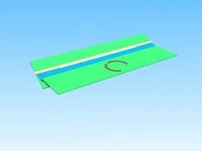

# Offline Donation · First Donations

Modèle en Parts « Offline Donation » (First Donations).

- **Catégorie** : [Bibliothèque 3D](../Biblioth%C3%A8que%203D.md)
- **Sous-catégorie** : [Assets de jeux](Assets%20de%20jeux%20%28Biblioth%C3%A8que%203D%29.md)
- **Type** : Modèle en Parts
- **Taille** : 145 × 14 × 90 studs
- **Contenu** : 15 Parts · 105 MeshParts
- **Jeu d'origine** : First Donations
- **Fichier source** : `models/FromGames/First_Donations/Workspace/OfflineDonation.rbxm` (dans ta bibliothèque `rblx\lib`)
