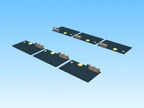

# Plots · Bakery Simulator

Modèle en Parts « Plots » (Bakery Simulator).

- **Catégorie** : [Bibliothèque 3D](../Biblioth%C3%A8que%203D.md)
- **Sous-catégorie** : [Assets de jeux](Assets%20de%20jeux%20%28Biblioth%C3%A8que%203D%29.md)
- **Type** : Modèle en Parts
- **Taille** : 151 × 6 × 93 studs
- **Contenu** : 204 Parts · 54 MeshParts
- **Jeu d'origine** : Bakery Simulator
- **Fichier source** : `Assets/models/FromGames/Bakery-Simulator/Workspace/Plots.rbxm` (dans le vault)
