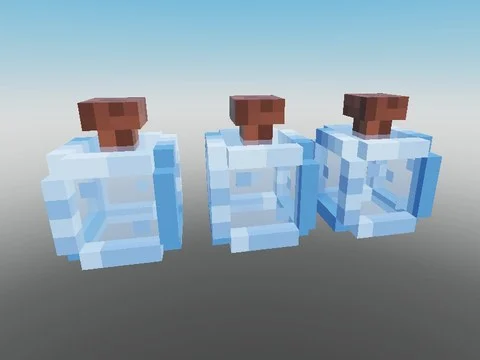

# Potions (Roll Speed, Luck, Mutation)

3 modèles de potions : Roll Speed Potion, Luck Potion et Mutation Potion ; aucun script.

- **Catégorie** : [Bibliothèque 3D](../Biblioth%C3%A8que%203D.md)
- **Sous-catégorie** : [Assets de jeux](Assets%20de%20jeux%20%28Biblioth%C3%A8que%203D%29.md)
- **Type** : Pack de fichiers
- **Contenu** : 4 fichiers · 40 Ko
- **Fichier source** : `Assets/packs/Potions` (dans le vault)

## Fichiers (4)

- `potions.rbxm`
- `Luck Potion.rbxm`
- `Mutation Potion.rbxm`
- `Roll Speed Potion.rbxm`
