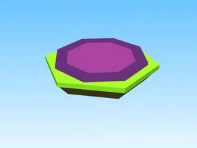

# Potions · Tapping Lords

Modèle en Parts « Potions » (Tapping Lords).

- **Catégorie** : [Bibliothèque 3D](../Biblioth%C3%A8que%203D.md)
- **Sous-catégorie** : [Assets de jeux](Assets%20de%20jeux%20%28Biblioth%C3%A8que%203D%29.md)
- **Type** : Modèle en Parts
- **Taille** : 25 × 1 × 25 studs
- **Contenu** : 10 Parts
- **Jeu d'origine** : Tapping Lords
- **Fichier source** : `models/FromGames/Tapping-Lords-Simulator/Workspace/Potions.rbxm` (dans ta bibliothèque `rblx\lib`)
