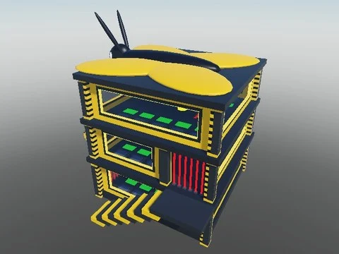

# Bee Base (by [DEV] Barcola)

Base sur le thème des abeilles par [DEV] Barcola (un modèle Base + script Read me).

- **Catégorie** : [Bibliothèque 3D](../Biblioth%C3%A8que%203D.md)
- **Sous-catégorie** : [Bâtiments](B%C3%A2timents%20%28Biblioth%C3%A8que%203D%29.md)
- **Type** : Pack de fichiers
- **Contenu** : 1 fichier · 72 Ko
- **Fichier source** : `Assets/packs/Bee Base/Bee Base made by [DEV] Barcola.rbxm` (dans le vault)
