# Bâtiments

Sous-catégorie de [Bibliothèque 3D](../Biblioth%C3%A8que%203D.md) · **22 éléments**

| Aperçu | Élément | Infos |
| --- | --- | --- |
| 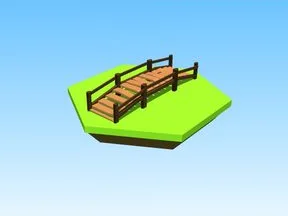 | [Bridge · Glass Bridge](Bridge%20%C2%B7%20Glass%20Bridge.md) | Modèle en Parts · 13 × 6 × 42 · 97 Parts |
| 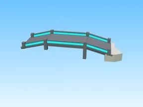 | [Bridge · Robot Simulator](Bridge%20%C2%B7%20Robot%20Simulator.md) | Modèle en Parts · 65 × 10 × 48 · 39 Parts |
| 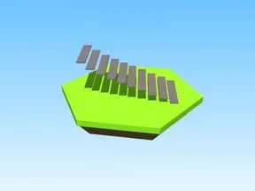 | [Bridge Stair Side1 · Robot Simulator](Bridge%20Stair%20Side1%20%C2%B7%20Robot%20Simulator.md) | Modèle en Parts · 10 × 6 × 8 · 10 Parts |
| 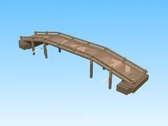 | [Bridge3 · Shoot A Brainrot](Bridge3%20%C2%B7%20Shoot%20A%20Brainrot.md) | Modèle en Parts · 154 × 21 × 23 · 94 Parts |
| 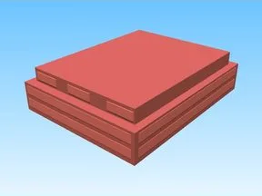 | [Building1 · Billionaire Tycoon](Building1%20%C2%B7%20Billionaire%20Tycoon.md) | Modèle en Parts · 46 × 14 × 1 · 9 Parts |
| 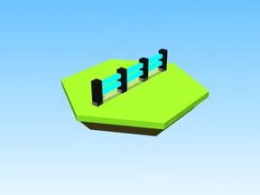 | [Fence · Cashgrab Bridge](Fence%20%C2%B7%20Cashgrab%20Bridge.md) | Modèle en Parts · 1 × 2 × 15 · 11 Parts |
| 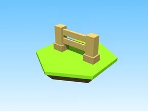 | [Fence Post · Punch Simulator](Fence%20Post%20%C2%B7%20Punch%20Simulator.md) | Modèle en Parts · 5 × 2 × 1 · 6 Parts |
|  | [Futuristic Build · Robot Simulator](Futuristic%20Build%20%C2%B7%20Robot%20Simulator.md) | Modèle en Parts · 62 × 99 × 59 · 87 Parts · 8 MeshParts |
|  | [House1a · Billionaire Tycoon](House1a%20%C2%B7%20Billionaire%20Tycoon.md) | Modèle en Parts · 39 × 26 × 31 · 186 Parts |
|  | [House1b · Billionaire Tycoon](House1b%20%C2%B7%20Billionaire%20Tycoon.md) | Modèle en Parts · 39 × 29 × 31 · 208 Parts |
| 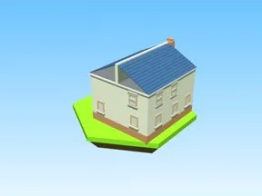 | [House1c · Billionaire Tycoon](House1c%20%C2%B7%20Billionaire%20Tycoon.md) | Modèle en Parts · 39 × 26 × 31 · 191 Parts |
| 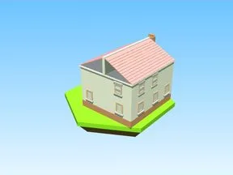 | [House2a · Billionaire Tycoon](House2a%20%C2%B7%20Billionaire%20Tycoon.md) | Modèle en Parts · 39 × 26 × 31 · 186 Parts |
| 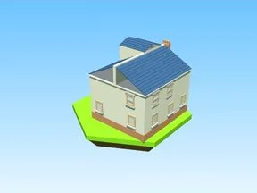 | [House2b · Billionaire Tycoon](House2b%20%C2%B7%20Billionaire%20Tycoon.md) | Modèle en Parts · 39 × 29 × 31 · 208 Parts |
| 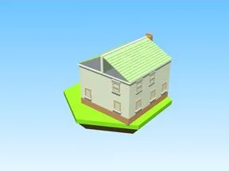 | [House2c · Billionaire Tycoon](House2c%20%C2%B7%20Billionaire%20Tycoon.md) | Modèle en Parts · 39 × 26 × 31 · 191 Parts |
|  | [House3a · Billionaire Tycoon](House3a%20%C2%B7%20Billionaire%20Tycoon.md) | Modèle en Parts · 39 × 26 × 31 · 186 Parts |
| 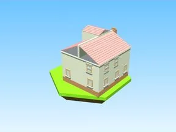 | [House3b · Billionaire Tycoon](House3b%20%C2%B7%20Billionaire%20Tycoon.md) | Modèle en Parts · 39 × 29 × 31 · 208 Parts |
|  | [House3c · Billionaire Tycoon](House3c%20%C2%B7%20Billionaire%20Tycoon.md) | Modèle en Parts · 39 × 26 × 31 · 191 Parts |
|  | [Out Door · Pet Pharmica](Out%20Door%20%C2%B7%20Pet%20Pharmica.md) | Modèle en Parts · 23 × 34 × 6 · 11 Parts |
| 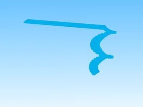 | [Stairs · Punch Simulator](Stairs%20%C2%B7%20Punch%20Simulator.md) | Modèle en Parts · 141 × 190 × 115 · 45 Parts |
|  | [Sun Building · Tweeting Simulator](Sun%20Building%20%C2%B7%20Tweeting%20Simulator.md) | Modèle en Parts · 48 × 42 × 94 · 17 Parts |
| 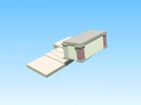 | [Sun Building 2 · Tweeting Simulator](Sun%20Building%202%20%C2%B7%20Tweeting%20Simulator.md) | Modèle en Parts · 132 × 105 × 148 · 24 Parts |
|  | [Verified Building · Tweeting Simulator](Verified%20Building%20%C2%B7%20Tweeting%20Simulator.md) | Modèle en Parts · 65 × 38 × 53 · 43 Parts · 2 MeshParts |
