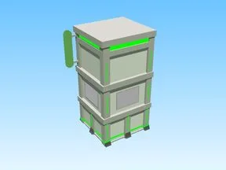

# Futuristic Build · Robot Simulator

Modèle en Parts « Futuristic Build » (Robot Simulator).

- **Catégorie** : [Bibliothèque 3D](../Biblioth%C3%A8que%203D.md)
- **Sous-catégorie** : [Bâtiments](B%C3%A2timents%20%28Biblioth%C3%A8que%203D%29.md)
- **Type** : Modèle en Parts
- **Taille** : 62 × 99 × 59 studs
- **Contenu** : 87 Parts · 8 MeshParts
- **Jeu d'origine** : Robot Simulator
- **Fichier source** : `models/ByType/Buildings/RobotSim_FuturisticBuild.rbxm` (dans ta bibliothèque `rblx\lib`)
