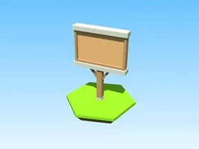

# Out Door · Pet Pharmica

Modèle en Parts « Out Door » (Pet Pharmica).

- **Catégorie** : [Bibliothèque 3D](../Biblioth%C3%A8que%203D.md)
- **Sous-catégorie** : [Bâtiments](B%C3%A2timents%20%28Biblioth%C3%A8que%203D%29.md)
- **Type** : Modèle en Parts
- **Taille** : 23 × 34 × 6 studs
- **Contenu** : 11 Parts
- **Jeu d'origine** : Pet Pharmica
- **Fichier source** : `models/ByType/Buildings/PetPharmica_OutDoor.rbxm` (dans ta bibliothèque `rblx\lib`)
