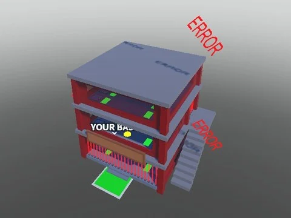

# SAB Bases Pack (bases Steal a Brainrot)

Pack de bases façon Steal a Brainrot : Base1/Base2, bâtiment « John Doe Made By Firefly01514 » (ThirdFloor), rig John et outil Sparkle.

- **Catégorie** : [Bibliothèque 3D](../Biblioth%C3%A8que%203D.md)
- **Sous-catégorie** : [Bâtiments](B%C3%A2timents%20%28Biblioth%C3%A8que%203D%29.md)
- **Type** : Pack de fichiers
- **Contenu** : 6 fichiers · 0,5 Mo
- **Jeu d'origine** : Steal a Brainrot
- **Fichier source** : `Assets/packs/SAB_Bases_pack` (dans le vault)

## Fichiers (6)

- `SAB_Bases_pack.rbxl`
- `Bases/John Doe Made By Firefly01514/ThirdFloor.rbxm`
- `Most of John Does Animations/John.rbxm`
- `Sparkle.rbxm`
- `Workspace/Bases/Base1.rbxm`
- `Workspace/Bases/Base2.rbxm`
