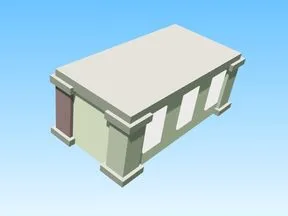

# Sun Building · Tweeting Simulator

Modèle en Parts « Sun Building » (Tweeting Simulator).

- **Catégorie** : [Bibliothèque 3D](../Biblioth%C3%A8que%203D.md)
- **Sous-catégorie** : [Bâtiments](B%C3%A2timents%20%28Biblioth%C3%A8que%203D%29.md)
- **Type** : Modèle en Parts
- **Taille** : 48 × 42 × 94 studs
- **Contenu** : 17 Parts
- **Jeu d'origine** : Tweeting Simulator
- **Fichier source** : `Assets/models/ByType/Buildings/TweetingSim_SunBuilding.rbxm` (dans le vault)
