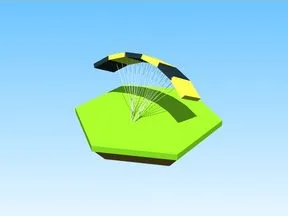

# Debug Glider · Robot Simulator

Modèle en Parts « Debug Glider » (Robot Simulator).

- **Catégorie** : [Bibliothèque 3D](../Biblioth%C3%A8que%203D.md)
- **Sous-catégorie** : [Chapeaux & accessoires](Chapeaux%20%26%20accessoires%20%28Biblioth%C3%A8que%203D%29.md)
- **Type** : Modèle en Parts
- **Taille** : 16 × 9 × 5 studs
- **Contenu** : 36 Parts
- **Jeu d'origine** : Robot Simulator
- **Fichier source** : `models/ByType/Accessories_Hats/RobotSim_DebugGlider.rbxm` (dans ta bibliothèque `rblx\lib`)
