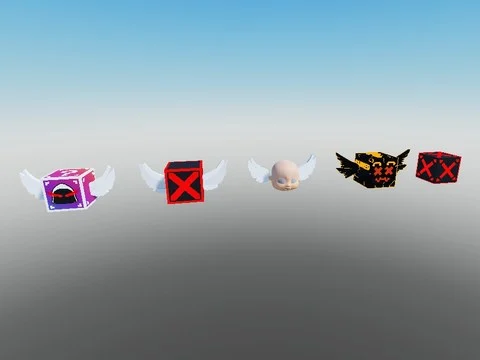

# Coffres & collectibles

Sous-catégorie de [Bibliothèque 3D](../Biblioth%C3%A8que%203D.md) · **10 éléments**

| Aperçu | Élément | Infos |
| --- | --- | --- |
|  | [Coin Chest · Robot Simulator](Coin%20Chest%20%C2%B7%20Robot%20Simulator.md) | Modèle en Parts · 29 × 2 × 29 · 29 Parts · 3 MeshParts |
|  | [Galaxy Gem Chest · Robot Simulator](Galaxy%20Gem%20Chest%20%C2%B7%20Robot%20Simulator.md) | Modèle en Parts · 31 × 2 × 31 · 29 Parts · 3 MeshParts |
|  | [Gem Chest · Robot Simulator](Gem%20Chest%20%C2%B7%20Robot%20Simulator.md) | Modèle en Parts · 31 × 2 × 31 · 29 Parts · 3 MeshParts |
|  | [Hidden Chest · Robot Simulator](Hidden%20Chest%20%C2%B7%20Robot%20Simulator.md) | Modèle en Parts · 10 × 8 × 11 · 39 Parts |
|  | [Pet XPChest · Robot Simulator](Pet%20XPChest%20%C2%B7%20Robot%20Simulator.md) | Modèle en Parts · 30 × 2 × 30 · 28 Parts · 3 MeshParts |
|  | [Premium Gem Chest · Robot Simulator](Premium%20Gem%20Chest%20%C2%B7%20Robot%20Simulator.md) | Modèle en Parts · 30 × 11 × 30 · 68 Parts |
|  | [VIPGem Chest · Robot Simulator](VIPGem%20Chest%20%C2%B7%20Robot%20Simulator.md) | Modèle en Parts · 29 × 11 × 29 · 68 Parts |
|  | [Coffres & collectibles — pack par type (13 modèles)](Coffres%20&%20collectibles%20%E2%80%94%20pack%20par%20type%20%2813%20mod%C3%A8les%29.md) | Pack de fichiers · 13 fichiers · 0,7 Mo |
|  | [Lucky Blocks (4 couleurs)](Lucky%20Blocks%20%284%20couleurs%29.md) | Modèle Roblox (.rbxm) · 1 fichier · 84 Ko |
|  | [Lucky Block Pack (by Egg)](Lucky%20Block%20Pack%20%28by%20Egg%29.md) | Pack de fichiers · 47 fichiers · 1,8 Mo |
