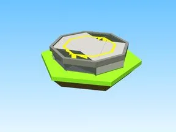

# Coin Chest · Robot Simulator

Modèle en Parts « Coin Chest » (Robot Simulator).

- **Catégorie** : [Bibliothèque 3D](../Biblioth%C3%A8que%203D.md)
- **Sous-catégorie** : [Coffres & collectibles](Coffres%20%26%20collectibles%20%28Biblioth%C3%A8que%203D%29.md)
- **Type** : Modèle en Parts
- **Taille** : 29 × 2 × 29 studs
- **Contenu** : 29 Parts · 3 MeshParts
- **Jeu d'origine** : Robot Simulator
- **Fichier source** : `models/ByType/Collectibles_Chests/RobotSim_CoinChest.rbxm` (dans ta bibliothèque `rblx\lib`)
