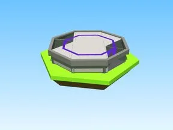

# Galaxy Gem Chest · Robot Simulator

Modèle en Parts « Galaxy Gem Chest » (Robot Simulator).

- **Catégorie** : [Bibliothèque 3D](../Biblioth%C3%A8que%203D.md)
- **Sous-catégorie** : [Coffres & collectibles](Coffres%20&%20collectibles%20%28Biblioth%C3%A8que%203D%29.md)
- **Type** : Modèle en Parts
- **Taille** : 31 × 2 × 31 studs
- **Contenu** : 29 Parts · 3 MeshParts
- **Jeu d'origine** : Robot Simulator
- **Fichier source** : `Assets/models/ByType/Collectibles_Chests/RobotSim_GalaxyGemChest.rbxm` (dans le vault)
