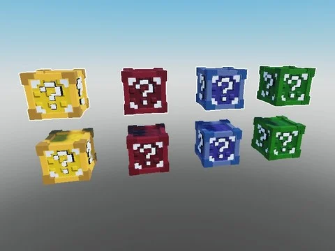

# Lucky Blocks (4 couleurs)

Lucky blocks de 4 couleurs (Red, Yellow, Blue, Green) + un modèle ; aucun script.

- **Catégorie** : [Bibliothèque 3D](../Biblioth%C3%A8que%203D.md)
- **Sous-catégorie** : [Coffres & collectibles](Coffres%20&%20collectibles%20%28Biblioth%C3%A8que%203D%29.md)
- **Type** : Modèle Roblox (.rbxm)
- **Contenu** : 1 fichier · 84 Ko
- **Fichier source** : `Assets/models/ByType/Collectibles_Chests/LuckyBlocks.rbxm` (dans le vault)
