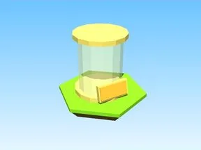

# 10KEgg · Tapping Lords

Modèle en Parts « 10KEgg » (Tapping Lords).

- **Catégorie** : [Bibliothèque 3D](../Biblioth%C3%A8que%203D.md)
- **Sous-catégorie** : [Divers](Divers%20%28Biblioth%C3%A8que%203D%29.md)
- **Type** : Modèle en Parts
- **Taille** : 3 × 6 × 1 studs
- **Contenu** : 5 Parts · 2 MeshParts
- **Jeu d'origine** : Tapping Lords
- **Fichier source** : `models/ByType/Misc/TappingLords_10KEgg.rbxm` (dans ta bibliothèque `rblx\lib`)
