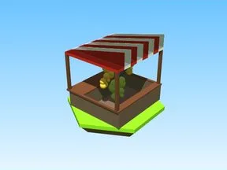
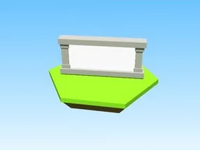
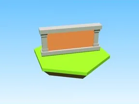

# Divers

Sous-catégorie de [Bibliothèque 3D](../Biblioth%C3%A8que%203D.md) · **10 éléments**

| Aperçu | Élément | Infos |
| --- | --- | --- |
|  | [10KEgg · Tapping Lords](10KEgg%20%C2%B7%20Tapping%20Lords.md) | Modèle en Parts · 3 × 6 × 1 · 5 Parts · 2 MeshParts |
|  | [Added Stuff Model · +1 Health Every Second](Added%20Stuff%20Model%20%C2%B7%20%2B1%20Health%20Every%20Second.md) | Modèle en Parts · 5 × 21 × 7 · 15 Parts |
|  | [Gears · +1 Jump Every Second](Gears%20%C2%B7%20%2B1%20Jump%20Every%20Second.md) | Modèle en Parts · 10 × 10 × 11 · 105 Parts · 40 MeshParts |
|  | [Image Ad Unit2 · Punch Simulator](Image%20Ad%20Unit2%20%C2%B7%20Punch%20Simulator.md) | Modèle en Parts · 21 × 10 × 1 · 10 Parts · 4 MeshParts |
|  | [Island1Sign · Robot Simulator](Island1Sign%20%C2%B7%20Robot%20Simulator.md) | Modèle en Parts · 8 × 4 × 5 · 12 Parts · 7 MeshParts |
|  | [Island2Sign · Robot Simulator](Island2Sign%20%C2%B7%20Robot%20Simulator.md) | Modèle en Parts · 8 × 4 × 5 · 12 Parts · 7 MeshParts |
|  | [Island3Sign · Robot Simulator](Island3Sign%20%C2%B7%20Robot%20Simulator.md) | Modèle en Parts · 6 × 4 × 8 · 12 Parts · 7 MeshParts |
|  | [Island4Sign · Robot Simulator](Island4Sign%20%C2%B7%20Robot%20Simulator.md) | Modèle en Parts · 4 × 4 × 8 · 12 Parts · 7 MeshParts |
|  | [Red · Cashgrab Bridge](Red%20%C2%B7%20Cashgrab%20Bridge.md) | Modèle en Parts · 7 × 9 × 3 · 11 Parts |
|  | [Streat · Pet Pharmica](Streat%20%C2%B7%20Pet%20Pharmica.md) | Modèle en Parts · 81 × 19 × 219 · 8 Parts |
