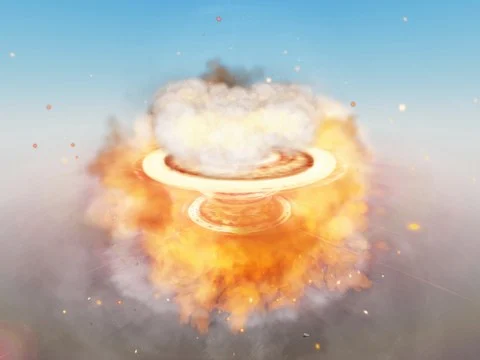

# Effets VFX & auras (7 fichiers)

Effets visuels : explosions, Malevolent Shrine, auras Aquatic/Galactic (SemiiDev, licence « apprendre seulement », interdites dans tes jeux) et PluginAssets (cascades, beams, particules).

- **Catégorie** : [Bibliothèque 3D](../Biblioth%C3%A8que%203D.md)
- **Sous-catégorie** : [Divers](Divers%20%28Biblioth%C3%A8que%203D%29.md)
- **Type** : Pack de fichiers
- **Contenu** : 7 fichiers · 0,7 Mo
- **Fichier source** : `Assets/models/VFX` (dans le vault)

## Fichiers (7)

- `PluginAssets.rbxl`
- `Auras/Aquatic_Aura_SemiiDev.rbxm`
- `Auras/Galactic_Aura_SemiiDev.rbxm`
- `Explosion_Slash.rbxm`
- `Malevolent_Shrine.rbxl`
- `Megumin_Explosion.rbxm`
- `PluginAssets_VFX.rbxm`
