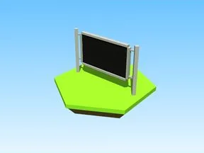

# Image Ad Unit2 · Punch Simulator

Modèle en Parts « Image Ad Unit2 » (Punch Simulator).

- **Catégorie** : [Bibliothèque 3D](../Biblioth%C3%A8que%203D.md)
- **Sous-catégorie** : [Divers](Divers%20%28Biblioth%C3%A8que%203D%29.md)
- **Type** : Modèle en Parts
- **Taille** : 21 × 10 × 1 studs
- **Contenu** : 10 Parts · 4 MeshParts
- **Jeu d'origine** : Punch Simulator
- **Fichier source** : `Assets/models/ByType/Misc/PunchSim_ImageAdUnit2.rbxm` (dans le vault)
