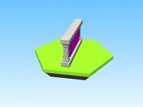

# Island4Sign · Robot Simulator

Modèle en Parts « Island4Sign » (Robot Simulator).

- **Catégorie** : [Bibliothèque 3D](../Biblioth%C3%A8que%203D.md)
- **Sous-catégorie** : [Divers](Divers%20%28Biblioth%C3%A8que%203D%29.md)
- **Type** : Modèle en Parts
- **Taille** : 4 × 4 × 8 studs
- **Contenu** : 12 Parts · 7 MeshParts
- **Jeu d'origine** : Robot Simulator
- **Fichier source** : `Assets/models/ByType/Misc/RobotSim_Island4Sign.rbxm` (dans le vault)
