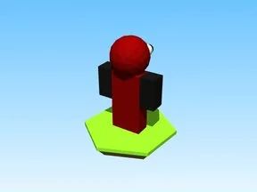

# Red · Cashgrab Bridge

Modèle en Parts « Red » (Cashgrab Bridge).

- **Catégorie** : [Bibliothèque 3D](../Biblioth%C3%A8que%203D.md)
- **Sous-catégorie** : [Divers](Divers%20%28Biblioth%C3%A8que%203D%29.md)
- **Type** : Modèle en Parts
- **Taille** : 7 × 9 × 3 studs
- **Contenu** : 11 Parts
- **Jeu d'origine** : Cashgrab Bridge
- **Fichier source** : `models/ByType/Misc/CashgrabBridge_Red.rbxm` (dans ta bibliothèque `rblx\lib`)
