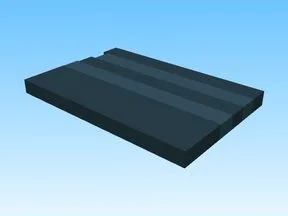

# Streat · Pet Pharmica

Modèle en Parts « Streat » (Pet Pharmica).

- **Catégorie** : [Bibliothèque 3D](../Biblioth%C3%A8que%203D.md)
- **Sous-catégorie** : [Divers](Divers%20%28Biblioth%C3%A8que%203D%29.md)
- **Type** : Modèle en Parts
- **Taille** : 81 × 19 × 219 studs
- **Contenu** : 8 Parts
- **Jeu d'origine** : Pet Pharmica
- **Fichier source** : `Assets/models/ByType/Misc/PetPharmica_Streat.rbxm` (dans le vault)
