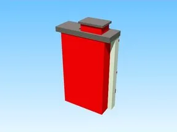

# Background Model 3 · Pet Pharmica

Modèle en Parts « Background Model 3 » (Pet Pharmica).

- **Catégorie** : [Bibliothèque 3D](../Biblioth%C3%A8que%203D.md)
- **Sous-catégorie** : [Décor](D%C3%A9cor%20%28Biblioth%C3%A8que%203D%29.md)
- **Type** : Modèle en Parts
- **Taille** : 39 × 68 × 11 studs
- **Contenu** : 80 Parts
- **Jeu d'origine** : Pet Pharmica
- **Fichier source** : `models/ByType/Decor_Props/PetPharmica_Background_Model_3.rbxm` (dans ta bibliothèque `rblx\lib`)
