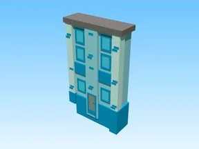

# Background Model 4 · Pet Pharmica

Modèle en Parts « Background Model 4 » (Pet Pharmica).

- **Catégorie** : [Bibliothèque 3D](../Biblioth%C3%A8que%203D.md)
- **Sous-catégorie** : [Décor](D%C3%A9cor%20%28Biblioth%C3%A8que%203D%29.md)
- **Type** : Modèle en Parts
- **Taille** : 43 × 70 × 9 studs
- **Contenu** : 62 Parts
- **Jeu d'origine** : Pet Pharmica
- **Fichier source** : `Assets/models/ByType/Decor_Props/PetPharmica_Background_Model_4.rbxm` (dans le vault)
