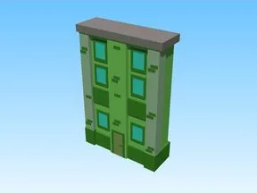
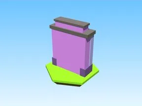
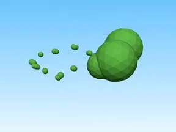
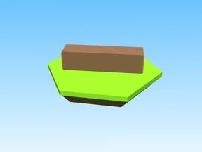
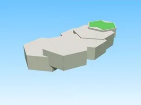
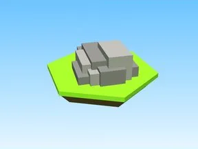
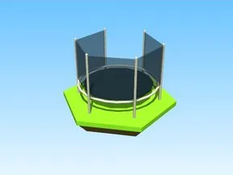

# Décor

Sous-catégorie de [Bibliothèque 3D](../Biblioth%C3%A8que%203D.md) · **19 éléments**

| Aperçu | Élément | Infos |
| --- | --- | --- |
|  | [Background Model · Pet Pharmica](Background%20Model%20%C2%B7%20Pet%20Pharmica.md) | Modèle en Parts · 42 × 65 × 11 · 61 Parts |
|  | [Background Model 2 · Pet Pharmica](Background%20Model%202%20%C2%B7%20Pet%20Pharmica.md) | Modèle en Parts · 42 × 54 × 10 · 53 Parts |
|  | [Background Model 3 · Pet Pharmica](Background%20Model%203%20%C2%B7%20Pet%20Pharmica.md) | Modèle en Parts · 39 × 68 × 11 · 80 Parts |
|  | [Background Model 4 · Pet Pharmica](Background%20Model%204%20%C2%B7%20Pet%20Pharmica.md) | Modèle en Parts · 43 × 70 × 9 · 62 Parts |
|  | [Box · Robot Simulator](Box%20%C2%B7%20Robot%20Simulator.md) | Modèle en Parts · 6 × 8 × 6 · 17 Parts |
|  | [Flag · Robot Simulator](Flag%20%C2%B7%20Robot%20Simulator.md) | Modèle en Parts · 1 × 36 × 1 · 5 Parts · 3 MeshParts |
|  | [Hexagon · Robot Simulator](Hexagon%20%C2%B7%20Robot%20Simulator.md) | Modèle en Parts · 22 × 1 × 19 · 6 Parts |
|  | [Hills · Tweeting Simulator](Hills%20%C2%B7%20Tweeting%20Simulator.md) | Modèle en Parts · 399 × 54 × 383 · 24 Parts |
|  | [Ice Spike · First Donations](Ice%20Spike%20%C2%B7%20First%20Donations.md) | Modèle en Parts · 4 × 9 × 4 · 31 Parts |
|  | [Log · Shoot A Brainrot](Log%20%C2%B7%20Shoot%20A%20Brainrot.md) | Modèle en Parts · 1 × 1 × 1 · 2 Parts |
|  | [Mini Hill · Robot Simulator](Mini%20Hill%20%C2%B7%20Robot%20Simulator.md) | Modèle en Parts · 27 × 15 × 92 · 20 Parts · 6 MeshParts |
|  | [Mountain Model · Robot Simulator](Mountain%20Model%20%C2%B7%20Robot%20Simulator.md) | Modèle en Parts · 30 × 16 × 31 · 176 Parts |
|  | [Paint · Glass Bridge](Paint%20%C2%B7%20Glass%20Bridge.md) | Modèle en Parts · 1 × 9 × 28 · 15 Parts |
|  | [Rock · Shoot A Brainrot](Rock%20%C2%B7%20Shoot%20A%20Brainrot.md) | Modèle en Parts · 4 × 1 × 5 · 9 Parts |
|  | [Training Areas 1 · Punch Simulator](Training%20Areas%201%20%C2%B7%20Punch%20Simulator.md) | Modèle en Parts · 31 × 11 × 38 · 63 Parts · 25 MeshParts |
|  | [Trampoline · Glass Bridge](Trampoline%20%C2%B7%20Glass%20Bridge.md) | Modèle en Parts · 18 × 10 × 19 · 42 Parts · 50 MeshParts |
|  | [Décor — pack par type (130 modèles)](D%C3%A9cor%20%E2%80%94%20pack%20par%20type%20%28130%20mod%C3%A8les%29.md) | Pack de fichiers · 130 fichiers · 2,8 Mo |
| — | [Spirit Blossom Shrine ⛩️](Spirit%20Blossom%20Shrine%20%E2%9B%A9%EF%B8%8F.md) | Modèle Roblox (.rbxm) · 1 fichier · 85 Ko |
| — | [Tree models (.obj)](Tree%20models%20%28.obj%29.md) | Pack de fichiers · 1 fichier · 66 Ko |
