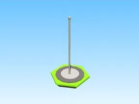

# Flag · Robot Simulator

Modèle en Parts « Flag » (Robot Simulator).

- **Catégorie** : [Bibliothèque 3D](../Biblioth%C3%A8que%203D.md)
- **Sous-catégorie** : [Décor](D%C3%A9cor%20%28Biblioth%C3%A8que%203D%29.md)
- **Type** : Modèle en Parts
- **Taille** : 1 × 36 × 1 studs
- **Contenu** : 5 Parts · 3 MeshParts
- **Jeu d'origine** : Robot Simulator
- **Fichier source** : `Assets/models/ByType/Decor_Props/RobotSim_Flag.rbxm` (dans le vault)
