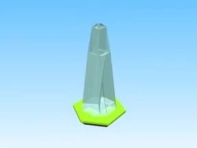

# Ice Spike · First Donations

Modèle en Parts « Ice Spike » (First Donations).

- **Catégorie** : [Bibliothèque 3D](../Biblioth%C3%A8que%203D.md)
- **Sous-catégorie** : [Décor](D%C3%A9cor%20%28Biblioth%C3%A8que%203D%29.md)
- **Type** : Modèle en Parts
- **Taille** : 4 × 9 × 4 studs
- **Contenu** : 31 Parts
- **Jeu d'origine** : First Donations
- **Fichier source** : `models/ByType/Decor_Props/FirstDonations_IceSpike.rbxm` (dans ta bibliothèque `rblx\lib`)
