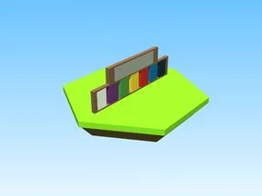

# Paint · Glass Bridge

Modèle en Parts « Paint » (Glass Bridge).

- **Catégorie** : [Bibliothèque 3D](../Biblioth%C3%A8que%203D.md)
- **Sous-catégorie** : [Décor](D%C3%A9cor%20%28Biblioth%C3%A8que%203D%29.md)
- **Type** : Modèle en Parts
- **Taille** : 1 × 9 × 28 studs
- **Contenu** : 15 Parts
- **Jeu d'origine** : Glass Bridge
- **Fichier source** : `models/ByType/Decor_Props/GlassBridge_Paint.rbxm` (dans ta bibliothèque `rblx\lib`)
