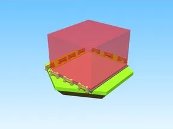

# Training Areas 1 · Punch Simulator

Modèle en Parts « Training Areas 1 » (Punch Simulator).

- **Catégorie** : [Bibliothèque 3D](../Biblioth%C3%A8que%203D.md)
- **Sous-catégorie** : [Décor](D%C3%A9cor%20%28Biblioth%C3%A8que%203D%29.md)
- **Type** : Modèle en Parts
- **Taille** : 31 × 11 × 38 studs
- **Contenu** : 63 Parts · 25 MeshParts
- **Jeu d'origine** : Punch Simulator
- **Fichier source** : `models/ByType/Decor_Props/PunchSim_TrainingAreas_1.rbxm` (dans ta bibliothèque `rblx\lib`)
