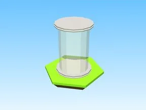
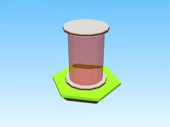

# Gadgets

Sous-catégorie de [Bibliothèque 3D](../Biblioth%C3%A8que%203D.md) · **4 éléments**

| Aperçu | Élément | Infos |
| --- | --- | --- |
|  | [Gravity Coil Giver · Cashgrab Bridge](Gravity%20Coil%20Giver%20%C2%B7%20Cashgrab%20Bridge.md) | Modèle en Parts · 1 × 7 × 1 · 5 Parts · 1 MeshPart |
|  | [Lantern · Glass Bridge](Lantern%20%C2%B7%20Glass%20Bridge.md) | Modèle en Parts · 1 × 2 × 1 · 11 Parts · 2 MeshParts |
|  | [Rainbow Magic Carpetgiver · Cashgrab Bridge](Rainbow%20Magic%20Carpetgiver%20%C2%B7%20Cashgrab%20Bridge.md) | Modèle en Parts · 1 × 7 × 1 · 5 Parts · 1 MeshPart |
|  | [Speed Coil Giver · Cashgrab Bridge](Speed%20Coil%20Giver%20%C2%B7%20Cashgrab%20Bridge.md) | Modèle en Parts · 1 × 7 × 1 · 5 Parts · 1 MeshPart |
