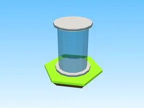

# Gravity Coil Giver · Cashgrab Bridge

Modèle en Parts « Gravity Coil Giver » (Cashgrab Bridge).

- **Catégorie** : [Bibliothèque 3D](../Biblioth%C3%A8que%203D.md)
- **Sous-catégorie** : [Gadgets](Gadgets%20%28Biblioth%C3%A8que%203D%29.md)
- **Type** : Modèle en Parts
- **Taille** : 1 × 7 × 1 studs
- **Contenu** : 5 Parts · 1 MeshPart
- **Jeu d'origine** : Cashgrab Bridge
- **Fichier source** : `models/ByType/Gear_Gadgets/CashgrabBridge_GravityCoilGiver.rbxm` (dans ta bibliothèque `rblx\lib`)
