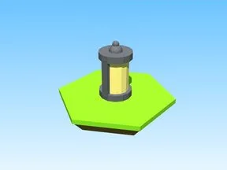

# Lantern · Glass Bridge

Modèle en Parts « Lantern » (Glass Bridge).

- **Catégorie** : [Bibliothèque 3D](../Biblioth%C3%A8que%203D.md)
- **Sous-catégorie** : [Gadgets](Gadgets%20%28Biblioth%C3%A8que%203D%29.md)
- **Type** : Modèle en Parts
- **Taille** : 1 × 2 × 1 studs
- **Contenu** : 11 Parts · 2 MeshParts
- **Jeu d'origine** : Glass Bridge
- **Fichier source** : `models/ByType/Gear_Gadgets/GlassBridge_Lantern.rbxm` (dans ta bibliothèque `rblx\lib`)
