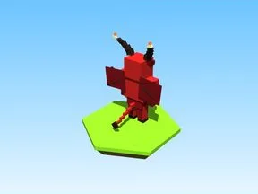

# Demon

Modèle en Parts « Demon ».

- **Catégorie** : [Bibliothèque 3D](../Biblioth%C3%A8que%203D.md)
- **Sous-catégorie** : [Halloween](Halloween%20%28Biblioth%C3%A8que%203D%29.md)
- **Type** : Modèle en Parts
- **Taille** : 7 × 13 × 7 studs
- **Contenu** : 61 Parts
- **Fichier source** : `packs/Halloween/Monsters/Demon.rbxm` (dans ta bibliothèque `rblx\lib`)
