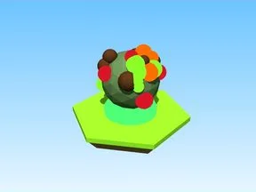

# Eggs v1

Modèle en Parts « Eggs v1 ».

- **Catégorie** : [Bibliothèque 3D](../Biblioth%C3%A8que%203D.md)
- **Sous-catégorie** : [Halloween](Halloween%20%28Biblioth%C3%A8que%203D%29.md)
- **Type** : Modèle en Parts
- **Taille** : 3 × 4 × 3 studs
- **Contenu** : 54 Parts
- **Fichier source** : `Assets/packs/Halloween/_Archive/Eggs_v1.rbxm` (dans le vault)
