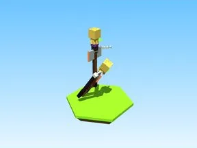
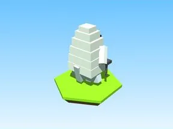
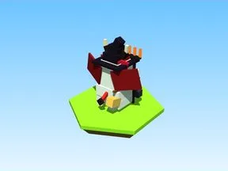
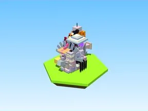
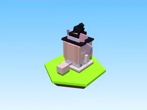
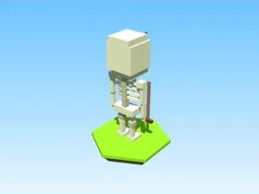
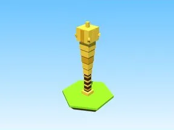
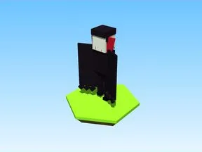
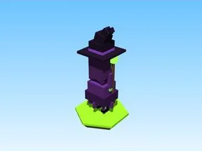

# Halloween

Sous-catégorie de [Bibliothèque 3D](../Biblioth%C3%A8que%203D.md) · **11 éléments**

| Aperçu | Élément | Infos |
| --- | --- | --- |
|  | [Backup](Backup.md) | Modèle en Parts · 3 × 8 × 4 · 68 Parts |
|  | [Demon](Demon.md) | Modèle en Parts · 7 × 13 × 7 · 61 Parts |
|  | [Eggs v1](Eggs%20v1.md) | Modèle en Parts · 3 × 4 × 3 · 54 Parts |
|  | [Ghost](Ghost.md) | Modèle en Parts · 5 × 7 × 3 · 32 Parts |
|  | [Guardians v2](Guardians%20v2.md) | Modèle en Parts · 7 × 11 × 7 · 114 Parts |
|  | [Items custom v1](Items%20custom%20v1.md) | Modèle en Parts · 8 × 12 × 11 · 4 930 Parts |
|  | [Items halloween v1](Items%20halloween%20v1.md) | Modèle en Parts · 6 × 11 × 8 · 570 Parts |
|  | [Skeleton](Skeleton.md) | Modèle en Parts · 4 × 9 × 2 · 62 Parts |
|  | [VIP Bat](VIP%20Bat.md) | Modèle en Parts · 1 × 5 × 1 · 23 Parts |
|  | [Vampire](Vampire.md) | Modèle en Parts · 5 × 9 × 3 · 40 Parts |
|  | [Witch](Witch.md) | Modèle en Parts · 4 × 13 × 3 · 55 Parts |
