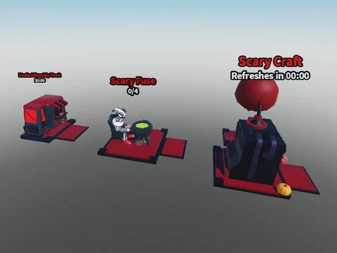

# Scary Pack (by Milo)

Pack Halloween par Milo : Scary Truck, Scary Fuse (machine de fusion) et Scary Craft.

- **Catégorie** : [Bibliothèque 3D](../Biblioth%C3%A8que%203D.md)
- **Sous-catégorie** : [Halloween](Halloween%20%28Biblioth%C3%A8que%203D%29.md)
- **Type** : Pack de fichiers
- **Contenu** : 4 fichiers · 0,6 Mo
- **Fichier source** : `Assets/packs/Scary Pack By Milo` (dans le vault)

## Fichiers (4)

- `Scary Pack By Milo.rbxm`
- `Scary Craft By Milo.rbxm`
- `Scary Fuse By Milo.rbxm`
- `Scary Truck By Milo.rbxm`
