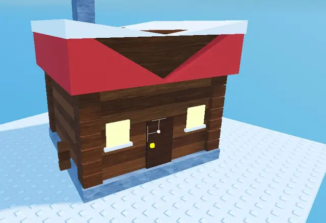

# Chalet en rondins

Chalet low-poly en rondins avec toit rouge enneigé, cheminée, fenêtres éclairées et porte. Utilisé autour du camp et dans le Village.

- **Catégorie** : [Bibliothèque 3D](../Biblioth%C3%A8que%203D.md)
- **Sous-catégorie** : [Hiver - Shovel for Eggs](Hiver%20-%20Shovel%20for%20Eggs%20%28Biblioth%C3%A8que%203D%29.md)
- **Type** : Modèle en Parts
- **Taille** : 14 × 14 × 13 studs (par élément)
- **Contenu** : 74 Parts
- **Fichier source** : `Assets/models/ShovelForEggs/ShovelForEggs_Chalet.rbxm` (dans le vault)
- **Créé pour** : Shovel for Eggs (style low-poly studs, palette hiver)
