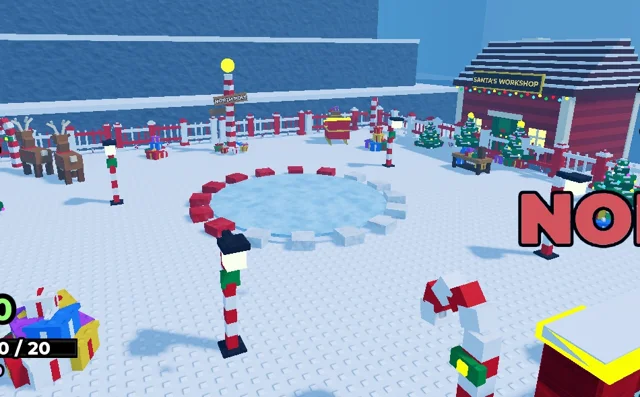

# Décor du Pôle Nord (Shovel for Eggs)

Tout le décor de la zone 7 en blocs à studs : atelier du Père Noël (briques, toit enneigé en escalier, cheminée qui fume, fenêtres lumineuses, guirlande, enseigne), sapin géant illuminé (boules néon, étoile), pôle Nord rayé avec boule dorée et panneaux, cannes à sucre, piles de cadeaux, rennes (dont Rudolph au nez lumineux), traîneau du Père Noël avec sac, établi des lutins avec jouets, lampadaires sucre d'orge, petits sapins, arche « NORTH POLE ».

- **Catégorie** : [Bibliothèque 3D](../Biblioth%C3%A8que%203D.md)
- **Sous-catégorie** : [Hiver - Shovel for Eggs](Hiver%20-%20Shovel%20for%20Eggs%20%28Biblioth%C3%A8que%203D%29.md)
- **Fichier source** : `Assets/models/ShovelForEggs/ShovelForEggs_NorthPole_Decor.rbxm` (dans le vault) · script `tools/build_northpole.lua`
