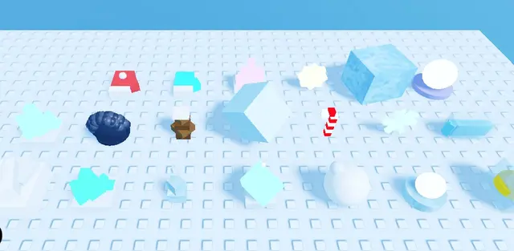
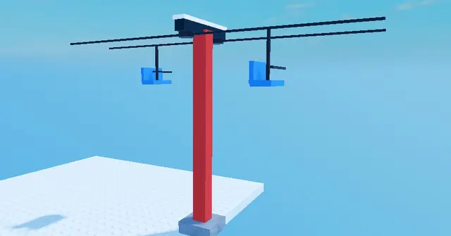
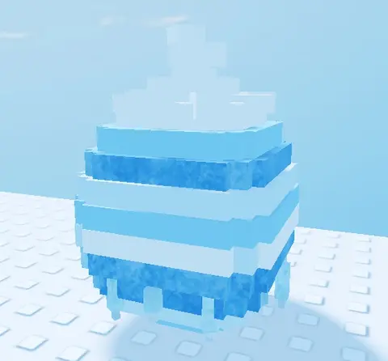
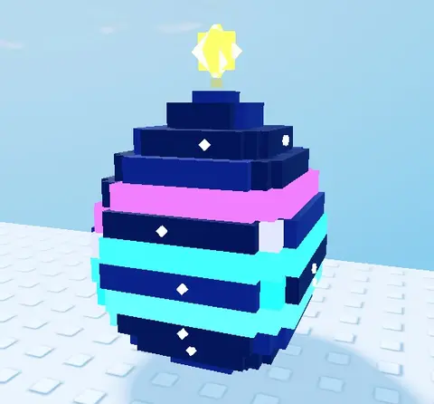
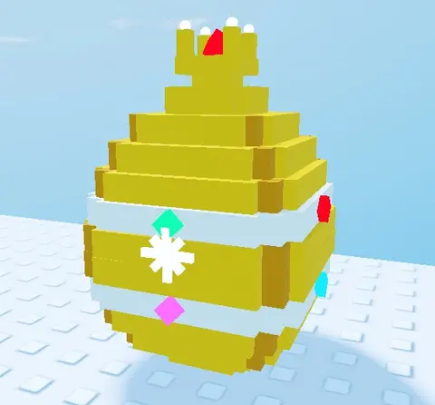

# Hiver - Shovel for Eggs

Sous-catégorie de [Bibliothèque 3D](../Biblioth%C3%A8que%203D.md) · **14 éléments** · créés pour le jeu Shovel for Eggs.

| Aperçu | Élément | Infos |
| --- | --- | --- |
|  | [Luges (Shovel for Eggs)](Luges%20%28Shovel%20for%20Eggs%29.md) | Pack de modèles en Parts · 3 × 3 × 6 · 6 modèles (Sled1 à Sled5 + Slot) · 173 Parts |
|  | [Objets de neige (Shovel for Eggs)](Objets%20de%20neige%20%28Shovel%20for%20Eggs%29.md) | Pack de modèles en Parts · 2 × 2 × 2 · 22 modèles · 252 Parts |
|  | [Pelles d'hiver (Shovel for Eggs)](Pelles%20d%27hiver%20%28Shovel%20for%20Eggs%29.md) | Pack de Tools · 5 × 9 × 5 · 12 Tools (Shovel1 à Shovel12) · 516 Parts |
|  | [Chalet en rondins](Chalet%20en%20rondins.md) | Modèle en Parts · 14 × 14 × 13 · 74 Parts |
|  | [Kit télésiège](Kit%20t%C3%A9l%C3%A9si%C3%A8ge.md) | Modèle en Parts · 8 × 18 × 26 · 16 Parts · 2 sièges (LiftChair) |
|  | [Œufs à studs (Shovel for Eggs)](%C5%92ufs%20%C3%A0%20studs%20%28Shovel%20for%20Eggs%29.md) | Pack de modèles en Parts · 4 × 7 × 4 · 7 œufs · ~850 Parts |
|  | [Œuf Snow (Shovel for Eggs)](%C5%92uf%20Snow%20%28Shovel%20for%20Eggs%29.md) | Modèle en Parts · 4 × 7 × 4 · 130 Parts |
|  | [Œuf Pine (Shovel for Eggs)](%C5%92uf%20Pine%20%28Shovel%20for%20Eggs%29.md) | Modèle en Parts · 4 × 8 × 4 · 116 Parts |
|  | [Œuf Frozen (Shovel for Eggs)](%C5%92uf%20Frozen%20%28Shovel%20for%20Eggs%29.md) | Modèle en Parts · 5 × 7 × 5 · 113 Parts |
|  | [Œuf Crystal (Shovel for Eggs)](%C5%92uf%20Crystal%20%28Shovel%20for%20Eggs%29.md) | Modèle en Parts · 5 × 7 × 5 · 132 Parts |
|  | [Œuf Glacier (Shovel for Eggs)](%C5%92uf%20Glacier%20%28Shovel%20for%20Eggs%29.md) | Modèle en Parts · 4 × 6 × 4 · 126 Parts |
|  | [Œuf Aurora (Shovel for Eggs)](%C5%92uf%20Aurora%20%28Shovel%20for%20Eggs%29.md) | Modèle en Parts · 4 × 7 × 4 · 112 Parts |
|  | [Œuf Golden (Shovel for Eggs)](%C5%92uf%20Golden%20%28Shovel%20for%20Eggs%29.md) | Modèle en Parts · 4 × 6 × 4 · 123 Parts |
|  | [Traîneaux v2 (Shovel for Eggs)](Tra%C3%AEneaux%20v2%20%28Shovel%20for%20Eggs%29.md) | Pack de modèles en Parts · 5 traîneaux · chargement animé |
