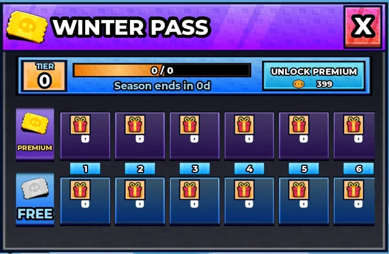

# Interfaces d'hiver (Shovel for Eggs)

Les interfaces des fonctions « qui font revenir le joueur », en vraies instances, style K4 (cartes texturées du Shop, icônes SimulatorIcons / Punch Sim / Training Sim / Bakery Sim) : calendrier de l'Avent (24 portes, guirlande), quêtes du jour (3 quêtes + bonus), Winter Pass (30 paliers, piste Premium / Free avec tickets), Starter Pack, gains hors ligne (x2), éclore maintenant, colonne HUD de droite avec pastilles, compteur de combo.

- **Catégorie** : [Bibliothèque 3D](../Biblioth%C3%A8que%203D.md)
- **Sous-catégorie** : [Hiver - Shovel for Eggs](Hiver%20-%20Shovel%20for%20Eggs%20%28Biblioth%C3%A8que%203D%29.md)
- **Fichier source** : `Assets/models/ShovelForEggs/ShovelForEggs_GUI_WinterFeatures.rbxm` (dans le vault) · scripts `tools/build_features_gui.lua`, `build_features_icons.lua`, `build_features_restyle.lua` · logique `Client/RewardsController`
