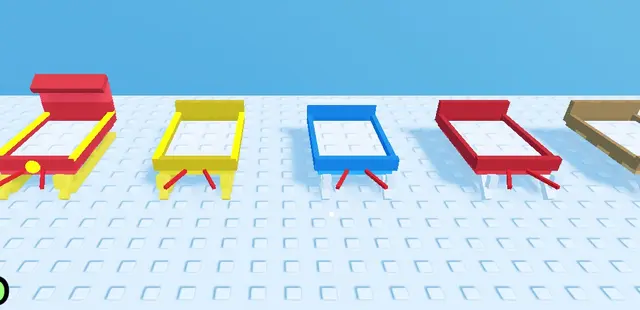

# Luges (Shovel for Eggs)

Les 5 luges du jeu (Wooden, Red, Blue, Golden, Santa Sleigh) en blocs avec studs, plus la carte « Slot » du shop. Chaque luge a une pièce « Load » (tas de neige) que le serveur fait grossir selon le remplissage. Pivot = milieu du bas, avant = -Z.

- **Catégorie** : [Bibliothèque 3D](../Biblioth%C3%A8que%203D.md)
- **Sous-catégorie** : [Hiver - Shovel for Eggs](Hiver%20-%20Shovel%20for%20Eggs%20%28Biblioth%C3%A8que%203D%29.md)
- **Type** : Pack de modèles en Parts
- **Taille** : 3 × 3 × 6 studs (par élément)
- **Contenu** : 6 modèles (Sled1 à Sled5 + Slot) · 173 Parts
- **Fichier source** : `Assets/models/ShovelForEggs/ShovelForEggs_Sleds.rbxm` (dans le vault)
- **Créé pour** : Shovel for Eggs (style low-poly studs, palette hiver)
