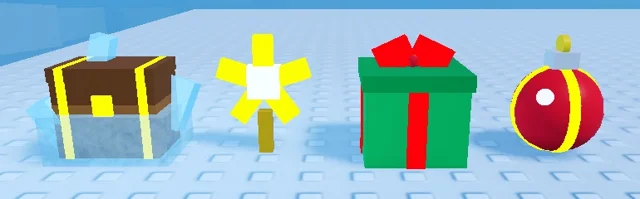

# Objets du Pôle Nord (Shovel for Eggs)

Les objets à creuser du Pôle Nord : Ornament (boule de Noël), Present (cadeau à ruban), StarTopper (étoile de sapin) et FrozenChest (coffre gelé rare : coque de glace, ferrures dorées, lumière et étincelles ; il donne argent + œuf + parfois un charm).

- **Catégorie** : [Bibliothèque 3D](../Biblioth%C3%A8que%203D.md)
- **Sous-catégorie** : [Hiver - Shovel for Eggs](Hiver%20-%20Shovel%20for%20Eggs%20%28Biblioth%C3%A8que%203D%29.md)
- **Fichier source** : `Assets/models/ShovelForEggs/ShovelForEggs_NorthPole_Items.rbxm` (dans le vault) · script `tools/build_snow_items.lua`
