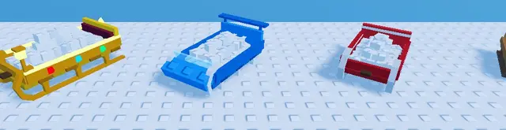

# Traîneaux v2 (Shovel for Eggs)

Les 5 traîneaux que le joueur traîne (version détaillée, remplace la v1 dans le jeu) : Wooden Sled (planches clouées, corde enroulée), Red Sled (patins recourbés, rayures), Blue Sled (bobsleigh : nez, pare-brise, aileron, phares), Golden Sled (liserés néon, gemmes, lanternes, coussin), Santa Sleigh (dossier recourbé, clochettes, cadeaux, sac, lanterne).

- **Chargement** : dossier `Cargo` de morceaux de neige numérotés (attribut `Order`) qui apparaissent un par un quand la luge se remplit (21 à 75 morceaux selon le traîneau).
- **Pour l'animation** : `Base` (PrimaryPart au sol), attachments `RopeAttach`, `SprayL/R`, `TrailL0/L1/R0/R1`.
- **Catégorie** : [Bibliothèque 3D](../Biblioth%C3%A8que%203D.md)
- **Sous-catégorie** : [Hiver - Shovel for Eggs](Hiver%20-%20Shovel%20for%20Eggs%20%28Biblioth%C3%A8que%203D%29.md)
- **Fichier source** : `Assets/models/ShovelForEggs/ShovelForEggs_Sleds_v2.rbxm` (dans le vault) · script `tools/build_sleds.lua`
