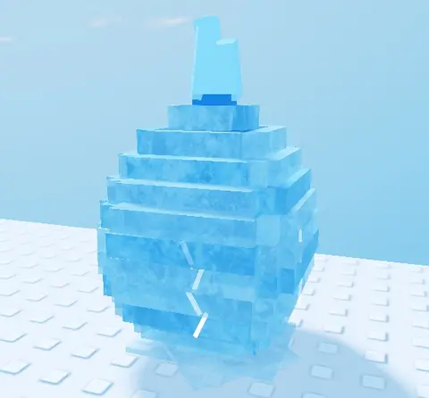

# Œuf Frozen (Shovel for Eggs)

Frozen Egg — zone **Frozen Lake**. Œuf en blocs à studs (tranches empilées, dessus Studs, dessous Inlet) : coquille de glace translucide (matériau Ice), cœur bleu profond, fissures blanches, flocons gravés, éclats de glace en verre, flaque gelée sous l'œuf.

- **Catégorie** : [Bibliothèque 3D](../Biblioth%C3%A8que%203D.md)
- **Sous-catégorie** : [Hiver - Shovel for Eggs](Hiver%20-%20Shovel%20for%20Eggs%20%28Biblioth%C3%A8que%203D%29.md)
- **Type** : Modèle en Parts
- **Taille** : 5 × 7 × 5 studs
- **Contenu** : 113 Parts
- **Pivot** : centre de la boîte englobante, posé au sol
- **Fichier source** : `Assets/models/ShovelForEggs/ShovelForEggs_Egg_Frozen.rbxm` (dans le vault)
- **Pack complet** : [Œufs à studs (Shovel for Eggs)](%C5%92ufs%20%C3%A0%20studs%20%28Shovel%20for%20Eggs%29.md)
