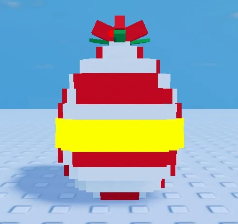

# Œuf North Pole (Shovel for Eggs)

Œuf de la zone 7 (Pôle Nord) en blocs à studs : spirale sucre d'orge rouge et blanche, ruban doré néon, gros nœud rouge, houx et baies. Œuf exclusif (10 % de chance de mutation Festive).

- **Catégorie** : [Bibliothèque 3D](../Biblioth%C3%A8que%203D.md)
- **Sous-catégorie** : [Hiver - Shovel for Eggs](Hiver%20-%20Shovel%20for%20Eggs%20%28Biblioth%C3%A8que%203D%29.md)
- **Fichier source** : `Assets/models/ShovelForEggs/ShovelForEggs_Egg_NorthPole.rbxm` (dans le vault) · script `tools/build_eggs.lua`
